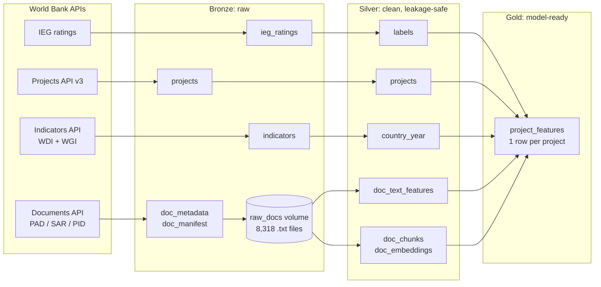
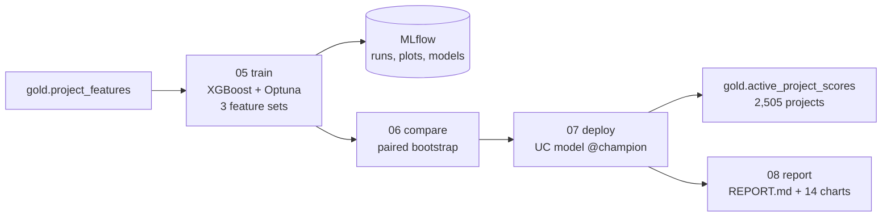
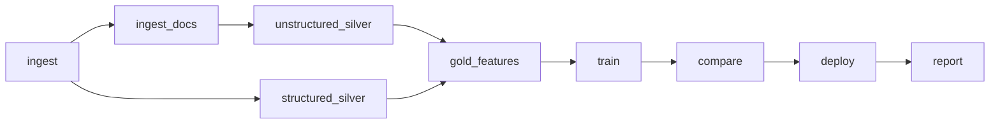

# World Bank Project Outcome Predictor

**Can we predict, on the day the World Bank Board approves a project, whether it will later be rated a success?**

An end-to-end ML pipeline on **Azure Databricks** that combines structured data (project attributes, country macro and governance indicators) with unstructured data (the text of ~8,300 pre-approval project documents) to predict the Independent Evaluation Group (IEG) outcome rating. Built with Delta Lake, Unity Catalog, MLflow, XGBoost, and Databricks Workflows.

## In one minute

- **The model's risk ranking works:** on projects it never saw (approved 2012 or later), the **riskiest 10% failed about 3× as often as the safest 10% (32% vs 11%)**, and the riskiest 20% contain 27.5% of all failures. That is the practical use: tell reviewers which new projects to watch first.
- **Overall accuracy is modest (test AUC 0.60), by nature of the problem:** outcomes are decided over 5–8 years of implementation that an approval-day model can't see.
- **Text vs structured (the main question):** the pre-approval documents predict outcomes on their own (AUC 0.58; almost as good as structured data at finding failures), but they mostly carry the *same* information as project + country data, so combining the two gives no significant gain (paired bootstrap −0.013, 95% CI [−0.032, +0.007]).
- **Rigor:** three problems caught and fixed before the final numbers — a "significant" text gain that was really tuning noise, a stacking leak through out-of-fold scores, and a broken readability feature ([details](#how-the-result-evolved-and-why-these-numbers-are-trustworthy)).
- **Platform:** bronze/silver/gold Delta tables in Unity Catalog → XGBoost + Optuna tracked in MLflow → model registered in Unity Catalog with alias `@champion` → batch scores for 2,505 active projects, all as one scheduled Workflow / Asset Bundle.


## Why Azure Databricks rather than Free Edition

I deliberately built this on **Azure Databricks (Premium trial)** to show a real cloud deployment — my own workspace, Unity Catalog, a dedicated cluster, a scheduled Workflow, and a Unity Catalog model registry — running entirely on trial credits (a single 4-core node that switches itself off after 10 idle minutes).

It can't run unchanged on **Databricks Free Edition**, for two reasons from the [Free Edition limitations](https://learn.microsoft.com/azure/databricks/getting-started/free-edition-limitations):
- Free Edition is **serverless-only** — no custom/dedicated clusters, while this workflow runs on a dedicated single-node Databricks Runtime ML cluster.
- Free Edition **restricts outbound internet to a limited set of trusted domains**, and this pipeline calls four World Bank APIs and downloads the embedding model from Hugging Face.

Porting to Free Edition would mean switching tasks to serverless compute with a declared environment (pip packages) and pre-loading the source data and model into a volume.

## Results

Test set = **2,217 projects approved FY2012 or later**, never used for training or tuning. Each model is the average of 3 independently tuned XGBoost models.

| Model | Validation AUC | **Test AUC** (95% CI) | PR-AUC on failures (random = 0.200) |
|---|---|---|---|
| **Structured** — project + country + track record | 0.613 | **0.602** [0.573, 0.630] | **0.269** |
| Text — document features, embeddings, TF-IDF score | 0.579 | 0.576 [0.547, 0.607] | 0.267 |
| Combined | 0.607 | 0.589 [0.559, 0.619] | 0.262 |

Paired bootstrap, combined − structured: **−0.013 AUC, 95% CI [−0.032, +0.007]**.

**Findings**
- Approval-day information predicts outcomes only modestly (AUC ≈ 0.60). That's expected: outcomes are largely decided during implementation, which an approval-day model can't see.
- **The ranking is still useful:** the 20% of test projects the champion rates riskiest fail **1.37× as often** as average and contain **27.5%** of all failures (failure rate rises from 11% in the safest decile to 32% in the riskiest).
- **The document text carries real signal on its own** (AUC 0.58; PR-AUC 0.267 vs 0.200 random), and it's interpretable: "civil service", "institutional framework", "private sector", "HIV/AIDS" lean toward failure; "roads", "rural", "maintenance", "emergency" toward success.
- **But it overlaps with the structured data, so it doesn't add on top.** That doesn't make it useless:
  - On its own it's clearly better than chance, and for *finding failures* it's almost as good as the structured model (PR-AUC 0.267 vs 0.269).
  - Both sources mostly describe the same things: what kind of project it is, where it is, and how hard the setting is. Once the model knows region, sector and country track record, the words repeat much of that.
  - So text works as a **substitute**, not an add-on. It may help most where structured data is thin, such as regional projects with no single country, or countries with no track record yet. That's worth testing; I haven't tested those groups here.
  - It also **explains in human words** what numbers can't ("civil service reform" vs "rural roads").
- Strongest structured drivers (SHAP): regional and country **track record** of earlier projects, **preparation time**, project size, GDP growth.

### Visual summary

All charts are produced by [`notebooks/08_results_report.py`](notebooks/08_results_report.py); the full report with tables is [`results/REPORT.md`](results/REPORT.md). Every notebook is also available **with its real outputs** in [`executed/`](executed/).

| | |
|---|---|
|  |  |
|  |  |

<details>
<summary><b>Exploratory analysis</b> — success over time, by region/sector, missing data, correlations, effect sizes, text features</summary>


</details>

<details>
<summary><b>More results</b> — TF-IDF terms, active-project risk</summary>


</details>

### How the result evolved (and why these numbers are trustworthy)

| Version | Change | Combined test AUC | Text gain vs structured |
|---|---|---|---|
| v1 | single validation window, one Optuna run | 0.588 | +0.016 (n.s.) |
| v2 | + track-record features, rolling-origin CV | 0.608 | **+0.035 (significant)** |
| v3 | same code, 17 more documents | 0.590 | +0.017 (n.s.) |
| v4 | each model = average of 3 independently tuned models | 0.595 | −0.007 (n.s.) |
| v5 | + supervised TF-IDF text score (random out-of-fold) | 0.591 | −0.011 (n.s.) |
| v6 | out-of-fold made **time-respecting** | 0.591 | −0.011 (n.s.) |
| **v7 (final)** | readability-feature bug fixed (see lesson 3) | **0.589** | **−0.013 (n.s.)** |

Three lessons:
1. **A single tuning run can manufacture a "significant" result.** The v2 gain vanished on a trivial re-run; averaging independently tuned models exposed it as tuning variance.
2. **Stacking leaks if out-of-fold scores ignore time.** Scoring a 2003 project with a model that saw 2009 projects inflated validation by ~0.05 (TF-IDF out-of-fold AUC 0.654 with random folds vs 0.542 time-respecting).
3. **Plot every feature before trusting it.** The EDA box plot showed "Flesch reading ease" values near −20,000 (valid range ≈ 0–100): sentences were counted on punctuation-free tokens, so the feature was secretly a length proxy. Fixing it moved text/combined AUC by only −0.002 — but a broken feature should never ship.

## Data

| Source | API | Used for |
|---|---|---|
| IEG World Bank Project Performance Ratings (12,627 projects) | Finances One `DS00053` | Label: Moderately Satisfactory or better = success |
| World Bank Projects API v3 (28,184 projects) | `search.worldbank.org/api/v3/projects` | Commitment, sector, region, preparation milestones |
| World Development Indicators + Worldwide Governance Indicators (15 series) | `api.worldbank.org/v2` | Country context in the year **before** approval |
| Documents & Reports (PAD, Staff Appraisal Report, Program Document, PID) | `search.worldbank.org/api/v2/wds` | Text of the latest pre-approval document per project |

Modelled population: 7,002 rated projects approved FY1995+ (train FY1995–2011, test FY2012+), plus 2,505 active projects scored by the deployed model.

## Architecture

**Data flow:** a medallion layout on Delta Lake, governed by Unity Catalog (catalog `dbw_wb_outcome`).



**Model and outputs:**



**Workflow** (`databricks.yml`, 9 tasks on one cluster):



## Leakage controls

| Risk | Control |
|---|---|
| Text describing the outcome | Only pre-approval document types, dated on/before Board approval; completion reports never used |
| Post-hoc IEG fields | Bank performance, quality ratings, closing dates, closing-year fragility status dropped |
| Revised project fields | Current closing date, status, effectiveness/ICR milestones not used |
| Macro data from implementation years | Indicators from approval year − 1; gaps filled forward only |
| Track record including the future | Only IEG ratings published before the approval year |
| Preprocessing peeking at test | PCA, one-hot vocabulary, TF-IDF vocabulary fit on train only |
| Stacking leak | TF-IDF score for training rows from models trained on earlier years only |
| Tuning on test | Time-based split; rolling-origin CV inside train; champion chosen by validation AUC |

## Repository layout

```
notebooks/
  00_README.py               results, theory map, limitations (Databricks notebook)
  00_setup.py                Unity Catalog schemas + volume, smoke test
  01_ingest.py               IEG ratings, Projects API, indicators → bronze
  01b_ingest_docs.py         document catalog, leakage-safe selection, parallel download
  02_structured_silver.py    labels, project features, country-year table
  03_unstructured_silver.py  text cleaning, keyword/readability features, MiniLM embeddings (incremental)
  04_gold_features.py        joins, track record, PCA, TF-IDF stacking, feature table with PK
  05_train.py                XGBoost + Optuna, rolling-origin CV, 3-seed ensemble, MLflow, SHAP
  06_compare.py              ablation with paired bootstrap
  07_deploy.py               UC registry @champion, batch scoring
  08_results_report.py       EDA + results: 14 charts and REPORT.md
executed/                    the same notebooks as .ipynb WITH the outputs of their final job runs
results/
  REPORT.md                  generated report (tables + charts)
  figures/                   14 PNG charts
databricks.yml               Asset Bundle: 9-task workflow (schedule paused)
```

**Why two formats?** `notebooks/*.py` is Databricks *source* format — plain text that diffs cleanly in git and is what the Asset Bundle deploys, but it can't hold outputs. `executed/*.ipynb` are snapshots of the actual job runs (printed results, tables, charts) so the work can be reviewed on GitHub without a workspace. Every code cell is preceded by a **What / Why** explanation.

## Reproduce

1. **Workspace:** Azure Databricks (Premium or Trial), Unity Catalog enabled. Notebooks use the catalog `dbw_wb_outcome` — change the `CATALOG` constant at the top of each notebook if yours differs.
2. **Cluster:** single node, Databricks Runtime **18 LTS ML** (CPU), Dedicated access mode, e.g. `Standard_D4ds_v4`, Photon off.
3. **Setup:** run `notebooks/00_setup.py` once (creates `bronze` / `silver` / `gold` / `ml` schemas and the `raw_docs` volume).
4. **Deploy and run** with the [Databricks CLI](https://learn.microsoft.com/azure/databricks/dev-tools/cli/):
   ```bash
   databricks bundle deploy --var cluster_id=<your-cluster-id>
   databricks bundle run wb_outcome_pipeline --var cluster_id=<your-cluster-id>
   ```
   A from-scratch run takes ~2 hours on 4 CPU cores (mostly document embeddings); later runs reuse cached documents and embeddings (~1 hour).

## Limitations

- Only projects that have closed and been rated are in the test period (selection bias toward shorter projects).
- 1990s Staff Appraisal Reports are OCR text with noise; regional projects have no single country for macro features.
- Embeddings cover ~1,600 words per document (CPU budget).
- No implementation-time signals by design — a natural extension is a "during implementation" model using supervision ratings and disbursement speed.

## Next steps

**1. Extend with LLMs (the documents are already chunked and embedded in `silver.doc_chunks` / `silver.doc_embeddings`)**
- **LLM risk-factor extraction → new features.** Have an LLM read each pre-approval document and return structured JSON: stated overall risk rating, top named risks, implementing-agency capacity concerns, number of components, design complexity. These become new columns in `gold.project_features`, tested with the same ablation and paired bootstrap. Still leakage-safe, because only pre-approval documents are read. Roughly 8,300 documents × ~6k tokens ≈ 50M input tokens, which is cheap with a small model via batch inference (`ai_query`).
- **RAG question-answering over the documents.** "Which approved projects describe weak procurement capacity in fragile states?" Retrieve from the existing chunk embeddings (Databricks AI Search, formerly Vector Search, or FAISS), answer only from retrieved passages, cite the document and project ID, and say "not found" when there's no evidence. Evaluate groundedness with MLflow's GenAI evaluation (LLM-as-judge) on a small labelled question set.
- **Reviewer notes for flagged projects.** For each High-risk active project, an LLM turns its top SHAP drivers plus the extracted risks into a 3-sentence "why this was flagged" note, so the score comes with a reason a person can check.

**2. Use the pre-1995 history (~5,500 more rated projects).** The ratings, project data and macro data are already in bronze; only gold filters them out. Run it as an experiment, not a default: add FY1975–1994 to training (structured features first, since there are no governance scores before 1996 and the scanned documents are noisy), keep the FY2012+ test set unchanged, and keep it only if test AUC improves. Older projects may teach patterns that no longer hold. An LLM or vision-model re-read of the scanned documents could then make their text usable too.

**3. A during-implementation model.** Predict again around year 2 using the Implementation Status and Results reports (supervision ratings), disbursement pace and closing-date extensions. Expect a much higher AUC; it answers a different question ("which running projects need rescue?").

**4. Production hardening**
- Run tasks on job clusters or serverless jobs instead of an all-purpose cluster (cheaper per hour, no idle time).
- Add a **champion/challenger gate**: only move `@champion` if the new model beats the current one on a held-out recent window.
- Add **Lakehouse Monitoring** on `gold.project_features` and the score distribution to catch data drift and changes in the source APIs.
- Turn the leakage rules into **tests**, e.g. assert every document date ≤ approval date and that no post-approval column reaches gold. Run them plus `databricks bundle validate` in CI on every push.
- Try an ordinal model on the full 6-point rating instead of the binary label.

## Tech stack

Azure Databricks · Delta Lake · Unity Catalog (volumes, feature table, model registry) · MLflow 3 (nested runs, pyfunc) · XGBoost 3 · Optuna · scikit-learn · sentence-transformers (all-MiniLM-L6-v2) · SHAP (TreeSHAP) · Databricks Workflows · Databricks Asset Bundles

Data © World Bank Group, licensed CC BY 4.0.
