# World Bank Project Outcome Predictor — results report

_Generated 2026-10-16 16:48 UTC by `08_results_report`._

## Data at a glance

| item | value |
|---|---|
| Rated projects (all years) | 12475 |
| Overall success rate (all years) | 73.7% |
| Modelled: rated, approved FY1995+ | 7002 |
|   train (FY1995–2011) / test (FY2012+) | 4785 / 2217 |
|   success rate train / test | 74.0% / 80.0% |
| Modelled projects with a pre-approval document | 95.1% |
| Active projects scored | 2505 |
| Features: structured / text | 60 / 46 |

## A. Exploratory analysis

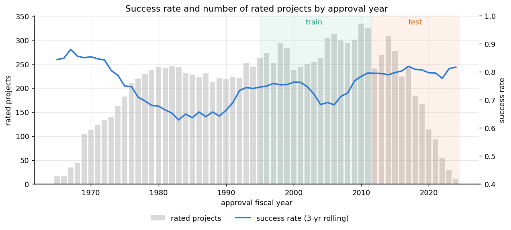

*Success rate by approval year (line, 3-year rolling) and number of rated projects (bars). Shaded: train FY1995–2011, test FY2012+.*

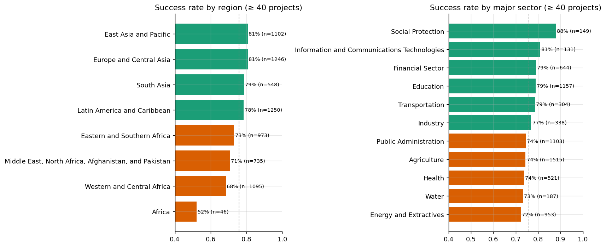

*Success rate by region and by major sector, projects approved FY1995+. Dashed line = overall rate.*

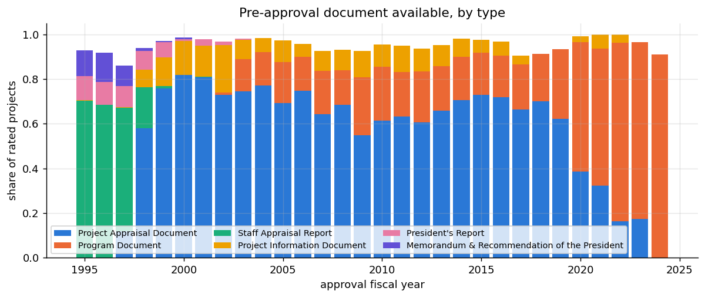

*Share of rated projects with a pre-approval document (dated on/before Board approval), by document type.*

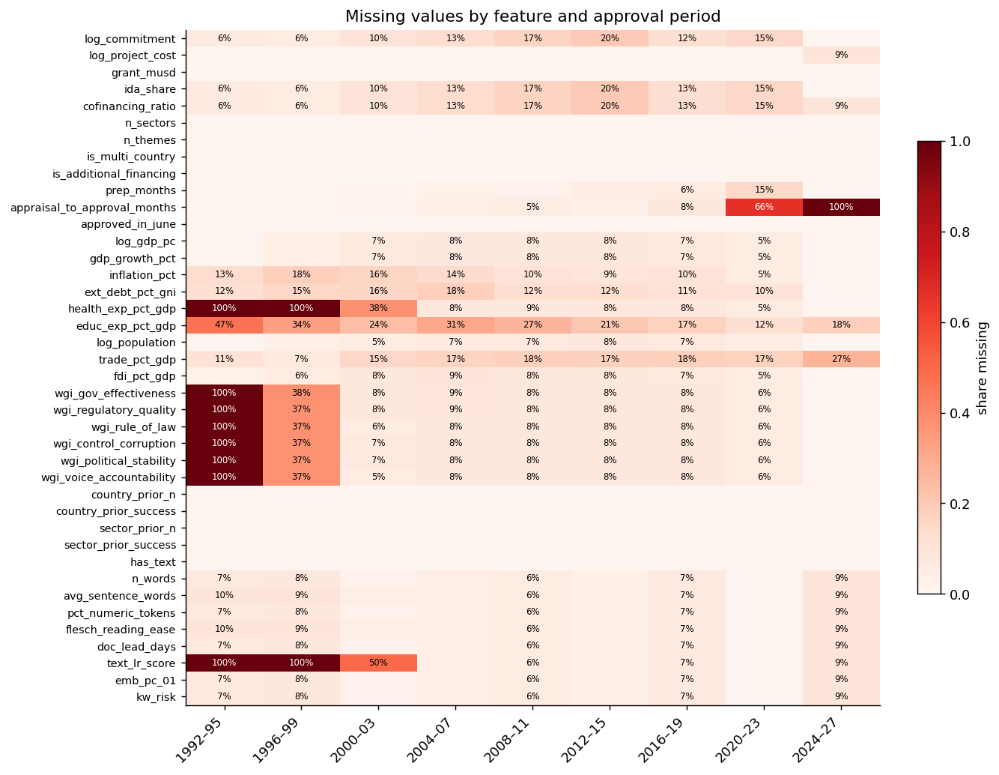

*Share of missing values per feature and 4-year approval period (modelled projects).*

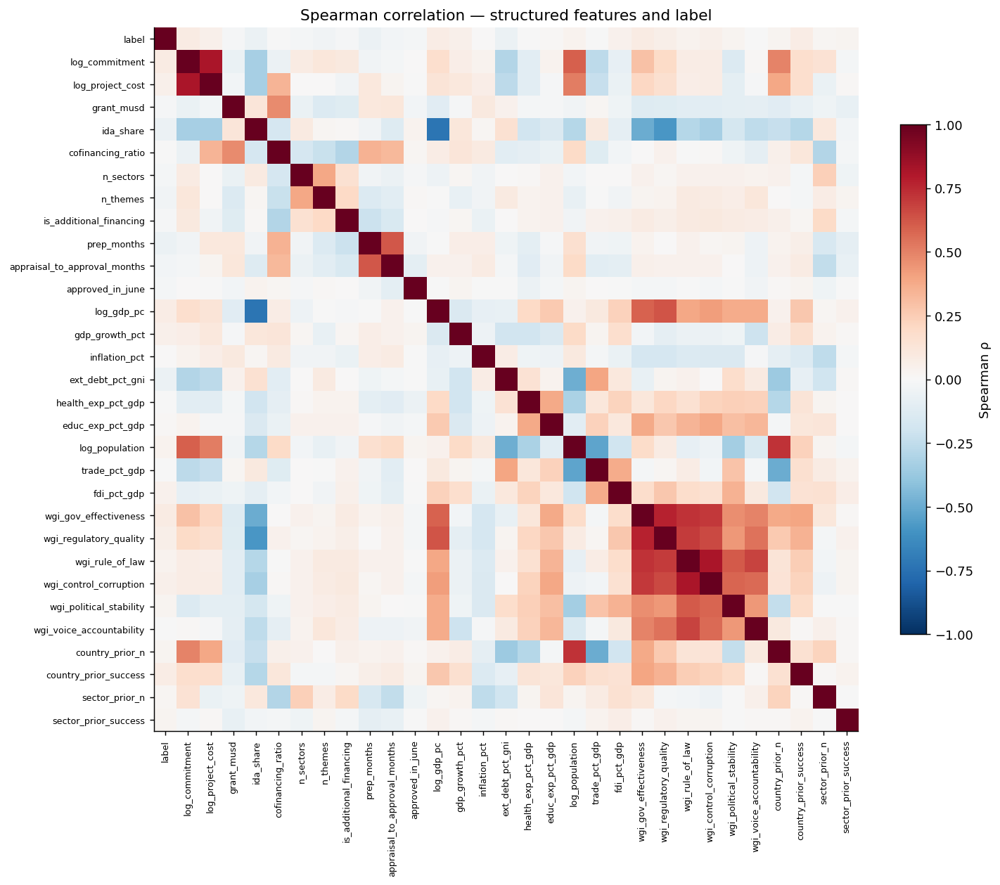

*Spearman correlation between structured features and the success label (modelled projects).*

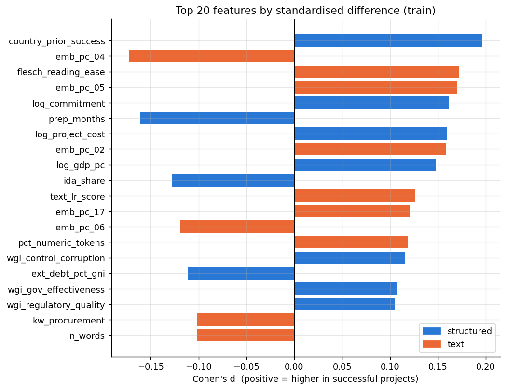

*Standardised mean difference (Cohen's d) between successful and failed projects, training years.*

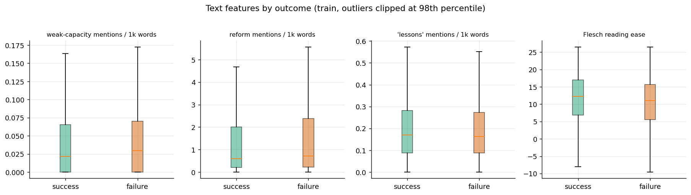

*Selected text features for successful vs failed projects (training years).*

## B. Model results

| feature_set | val_auc | test_auc | auc_ci_low | auc_ci_high | pr_auc_failure | pr_auc_random_baseline | brier |
|---|---|---|---|---|---|---|---|
| structured | 0.613 | 0.602 | 0.573 | 0.630 | 0.269 | 0.200 | 0.160 |
| text | 0.579 | 0.576 | 0.547 | 0.607 | 0.267 | 0.200 | 0.162 |
| combined | 0.607 | 0.589 | 0.559 | 0.619 | 0.262 | 0.200 | 0.163 |

Paired bootstrap (2,000 resamples of the test set):

| comparison | auc_gain | ci_low | ci_high | share_gain_le_0 |
|---|---|---|---|---|
| combined - structured | -0.013 | -0.032 | 0.007 | 0.902 |
| combined - text | 0.013 | -0.009 | 0.036 | 0.122 |
| text - structured | -0.026 | -0.057 | 0.004 | 0.950 |

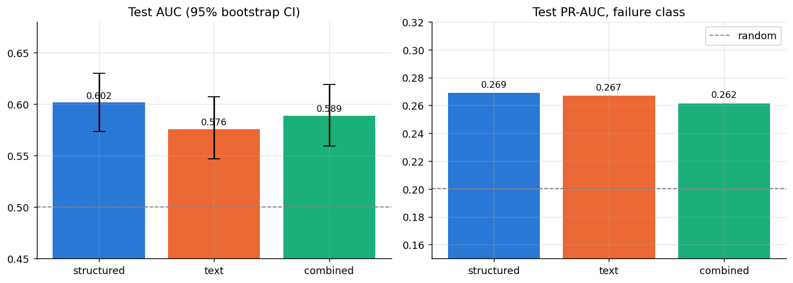

*Test AUC with 95% bootstrap intervals and PR-AUC for the failure class, by feature set.*

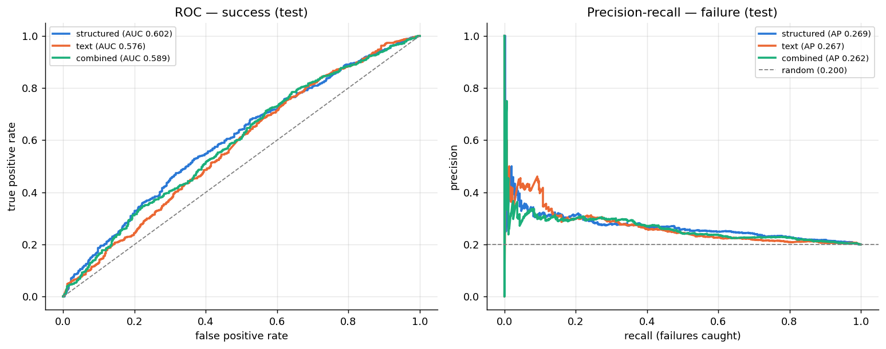

*ROC (success) and precision-recall (failure) curves on the test set.*

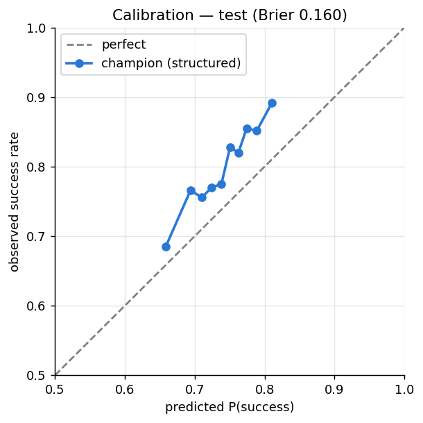

*Calibration of the champion model (v7, structured) on the test set, 10 quantile bins.*

**Risk ranking:** the riskiest 20% of test projects fail at 27.5% vs 20.0% overall (lift 1.37×) and contain 27% of all failures.

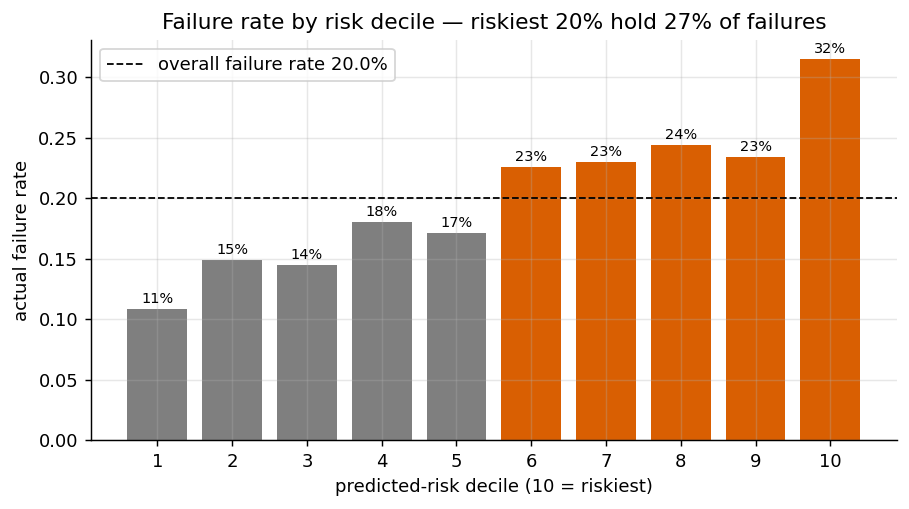

*Actual failure rate by champion-predicted risk decile on the test set.*

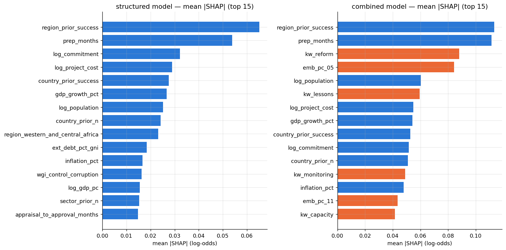

*Mean absolute SHAP value per feature on test (blue = structured, orange = text).*

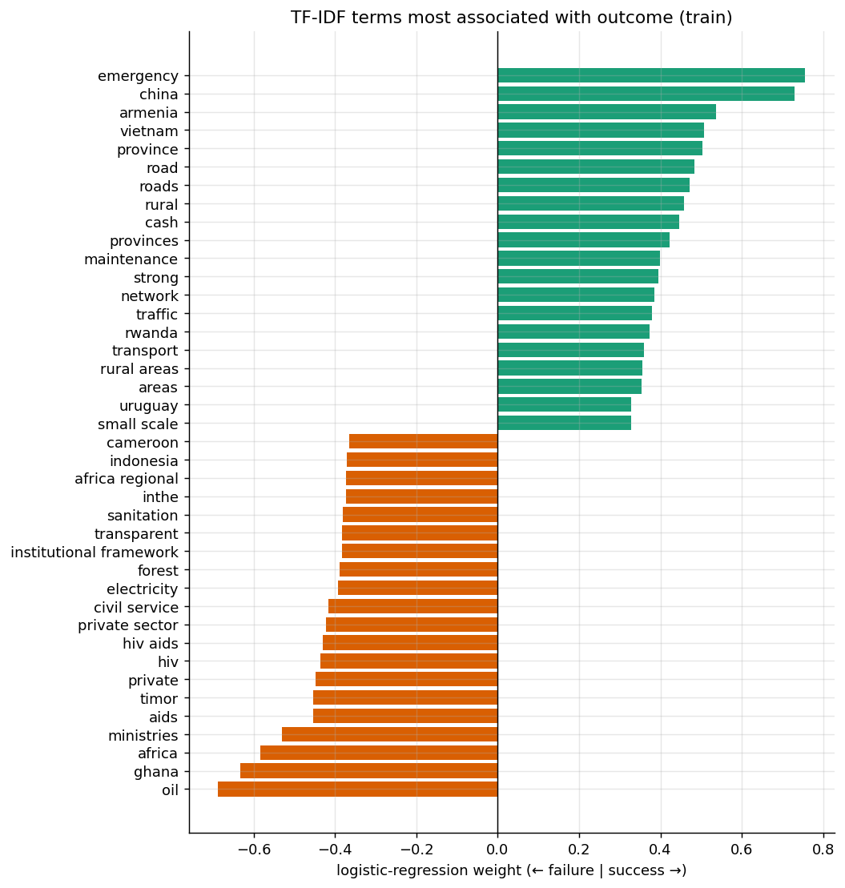

*Words and phrases with the largest TF-IDF logistic-regression weights (training documents).*

## C. Deployed model on active projects

Ten highest-risk active projects (model output, not a judgement on the projects):

| risk_rank | project_id | project_name | country_name | approval_fy | risk_of_failure |
|---|---|---|---|---|---|
| 1 | P177372 | Gabon Urban Development Project | Gabon | 2025 | 0.419 |
| 2 | P505271 | Republic of Congo - Poultry and Aquaculture Development Project | Congo, Republic of | 2027 | 0.402 |
| 3 | P179190 | Republic of Congo Strengthening Urban Resilience Project | Congo, Republic of | 2026 | 0.399 |
| 4 | P161877 | DRC Transport and Connectivity Support Project | Congo, Democratic Republic of | 2022 | 0.394 |
| 5 | P168772 | Valorization of Investments in the Valley of the Logone | Cameroon | 2022 | 0.391 |
| 6 | P171658 | Bamako Urban Resilience project | Mali | 2023 | 0.389 |
| 7 | P172422 | Senegal Cadastre and Land Tenure Improvement Project | Senegal | 2021 | 0.383 |
| 8 | P171933 | Ghana Landscape Restoration and Small-Scale Mining Project | Ghana | 2022 | 0.382 |
| 9 | P164330 | Greater Accra Resilient and Integrated Development Project | Ghana | 2019 | 0.381 |
| 10 | P180017 | Cameroon Second Fiscal Sustainability, Inclusive and Sustainable Growth Development Policy Financing | Cameroon | 2025 | 0.381 |

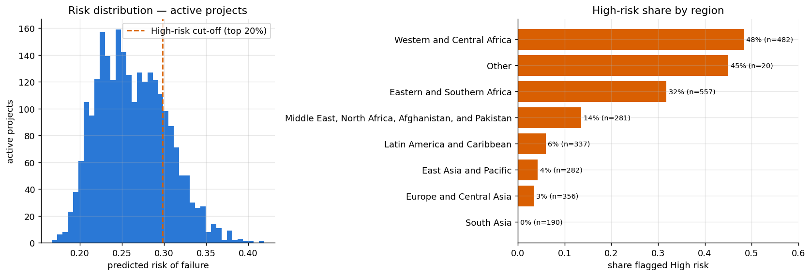

*Predicted failure risk for active projects and the share flagged High risk by region.*
